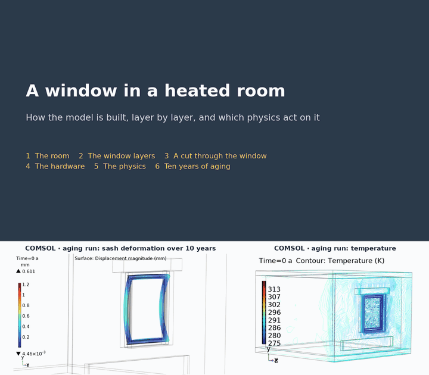

# Digital Twin Window: Ten Years of Aging of a Turn-Tilt Window in a Heated Room (COMSOL Finite Element Model)




A continuum digital twin of a turn-tilt window in a heated room. The model reproduces the window as it is built: fixed frame, openable sash, rebate gap and centre gasket, corner bearing, scissor stay and four locking points, double glazing on EPDM bedding and diagonal setting blocks, all set in a PU-foam joint in a masonry wall under a concrete lintel. Heat transfer, the weights of building and window, and thermal expansion are coupled, and the window is followed through ten years of seasons in one continuous time-dependent run. Its soft parts have material memory, and hinge wear and permanent set build up over the years, so the model shows how the sash slowly drifts out of alignment with its frame.

## Repository contents

| File | Description |
|---|---|
| `Window_DigitalTwin.mph` | COMSOL model file (6.3), saved without solution |
| `Window_DigitalTwin.java` | Model file for Java that builds the complete model from scratch |
| `Window_DigitalTwin.gif` | Animation: how the model is built (top) and COMSOL results of the ten-year aging run (bottom) |

## Why its a digital twin

- **One specific window, as built.** Not a generic window: its own frame, sash, hardware, joints and glazing, in its own wall, room and climate.
- **Physics, not curve fitting.** The behaviour follows from continuum mechanics and heat transfer, so every result can be traced back to a cause: temperature, weight, relaxation or wear.
- **It ages like the real one.** One continuous run carries the state of the window forward in time. What happened earlier, how long and how hard a gasket was squeezed and how warm it was, affects the state today.
- **The same symptoms as on site.** The outputs are what a fitter measures or a user notices: gaps between sash and frame, a dropping lock corner, a sash that starts to rub, a gasket that no longer seals.
- **Made to be updated.** Climate, heating, material relaxation and hinge wear are inputs that can be replaced by measured data from the real window. Once calibrated, the twin can predict the fit years ahead and test what-if scenarios, such as an earlier hinge adjustment, a different gasket or another climate.

## Highlights

### Material memory

The soft parts (centre gasket, glazing bedding, PU-foam joint, hinge and lock bushings, setting blocks) are viscoelastic. Each has its full stiffness right after loading and relaxes towards a long-term stiffness with its own time constant. Because the whole ten years are one time-dependent run, the strains of the relaxing branch are carried forward: loads applied earlier keep acting, stresses relax under sustained load, and parts partly recover when a load drops. The window literally remembers its past.

### Hinge settlement: the part that keeps adding up

Real sashes drop mainly through wear and play in the hinges and permanent set of the setting blocks. The model builds this in as strains that grow over the years in the corner bearing (it sinks), the scissor stay (its play lets the sash top move away from the jamb) and the load-bearing setting blocks. The twin then computes the consequences: how far the lock corner drops, which gaps close, and when the sash would start to rub.

### A realistic window

- Fixed frame and openable sash with the 5 mm rebate gap between them, and the EPDM centre gasket in that gap
- Turn-tilt hardware: corner bearing (carries the sash weight), scissor stay (holds the sash top) and four locking points
- Locks that behave like real cams in keepers: stiff out of plane, so they press the sash onto the gasket, soft in plane, so the hinges carry the sash weight
- Double glazing 4-14-4 seated 15 mm deep in the sash on EPDM bedding, on two load-bearing setting blocks placed diagonally and two distance blocks
- PU-foam installation joint between frame and wall, concrete lintel over the opening, panel heater in front of the wall below the window

### Seasons, heating and sun in one model

Every part expands and shrinks at its own temperature, so aluminium, glass, masonry and rubber move by different amounts. The outdoor temperature follows the seasons, the heater power follows the outdoor temperature, and the sun adds heat on facade, frame and glazing.

## Model overview

| Aspect | Setting |
|---|---|
| Geometry | 3D. Room 4 × 4 × 3 m inside with 30 cm masonry walls, 20 cm concrete floor and ceiling slabs and a concrete lintel; window 1.23 × 1.48 m at mid-depth of the wall |
| Window | Fixed frame (50 mm face, 75 mm deep) in a 12 mm PU-foam joint; sash (65 mm face) with a 5 mm rebate gap; EPDM centre gasket; corner bearing, scissor stay, four locking points; glazing 4-14-4 on EPDM bedding with setting blocks |
| Heating | Panel heater 3.0 × 0.40 m, 4 cm in front of the wall; power follows the outdoor temperature |
| Physics | Heat Transfer in Solids and Solid Mechanics, coupled by Thermal Expansion |
| Climate | Seasonal curve of monthly mean outdoor temperatures; sun as absorbed heat flux; room air at 20 °C; neighbour rooms at 18 °C |
| Loads | Window self-weight, building self-weight, dead and live load of the storeys above; wind load available as a switch |
| Material memory | Viscoelastic soft parts, one relaxing branch each (standard linear solid) |
| Hinge settlement | Growing built-in strains in corner bearing, scissor stay and setting blocks |
| Building creep | Masonry and concrete creep under the building's weight (effective-modulus method) |
| Kinematics | Quasi-static mechanics; the state is carried through the whole run |
| Problem size | ≈ 0.66 million degrees of freedom plus 1.4 million internal ones; the ten-year run took 15 min on 40 cores (2 × Intel Xeon Gold 6138, about 10 GB of memory) |
| Solver | Time dependent, BDF (Study 1); segregated stationary solver (Study 2) |

### Studies

| Study | Type | Question it answers |
|---|---|---|
| 1 Aging with memory | Time dependent, 0 → 10 years, one click | How does the fit between sash and frame drift over the years? |
| 2 Design winter day check | Stationary, −5 °C outside, new materials | Does the sash still fit on the coldest day, right after installation? |

In Study 1 the model starts unloaded at 20 °C. All loads are applied during the first day and the temperatures settle within days; the state after about 18 days is the installation reference. From there the run continues without restarting, and results are reported as the change since installation. The time grid is set by `dt_out` (output interval, default three months) and `t_end` (duration, default ten years). Study 2 switches the viscoelastic material off, so the soft parts use their stiffness as new.

## Results

The bottom of the animation shows Study 1 at its 44 output times, deformation and temperature side by side at the same moment.

- **Seasonal breathing.** Every winter the cold outer faces of frame and sash shrink and the sash sides bow; every summer they recover. This part is reversible.
- **Cumulative drift.** On top of the seasonal swing, the sash drifts from year to year as the soft parts relax and the hinges settle. The largest displacement in the window grows from about 0.77 mm in the first winter to about 1.23 mm in the winter of year 10, now concentrated at the top corner on the lock side (values from the colour legend of the animation).
- **Temperature.** The window wall cools every winter and evens out in summer; across the ten years the temperatures in the model range from about 275 K (outer glazing surface in winter) to about 313 K (heater surroundings).

### Plausibility checks

- **Coldest surface.** A heat balance of the outer glazing surface in winter (outdoor air 0.5 °C, glazing U = 1.1 W/(m²K), outer surface coefficient 25 W/(m²K), absorbed sun about 19 W/m²) gives about 2 °C (275 K). This matches the lowest temperature in the model.
- **Seasonal swing.** A 1.23 m aluminium profile cooled from 20 to 0.5 °C shortens by about 0.56 mm (α = 23.4 µm/(m·K)), the same order as the displacement difference between summer and winter frames.

## How to run

### Option A: open the model file

Open `Window_DigitalTwin.mph` in COMSOL 6.3 or newer and run *Study 1 > Compute* (the ten-year aging run) and *Study 2 > Compute* (the design-day check). The file is saved without a solution to keep it small.

### Option B: build from the Java file

The Java file is not tied to the COMSOL version that saved it, unlike the `.mph`. Compile it with the `comsolcompile` of your own installation.

Windows (PowerShell; note the `&`):

```powershell
& "C:\Program Files\COMSOL\COMSOL63\Multiphysics\bin\win64\comsolcompile.exe" .\Window_DigitalTwin.java
```

Linux / macOS:

```bash
comsol compile Window_DigitalTwin.java
```

Then either open `Window_DigitalTwin.class` in COMSOL (*File > Open*) and save the model as `.mph`, or build it in batch mode:

```powershell
& "C:\Program Files\COMSOL\COMSOL63\Multiphysics\bin\win64\comsolbatch.exe" -inputfile "$PWD\Window_DigitalTwin.class" -outputfile "$PWD\Window_DigitalTwin.mph"
```

### Option C: run on a cluster

Solve each study explicitly; the second run starts from the output of the first, so the final file holds both solutions.

```bash
comsol batch -inputfile Window_DigitalTwin.mph -outputfile Window_DigitalTwin_std1.mph -study std1 -batchlog std1.log
comsol batch -inputfile Window_DigitalTwin_std1.mph -outputfile Window_DigitalTwin_solved.mph -study std2 -batchlog std2.log
```

### Requirements

- COMSOL Multiphysics 6.3: the `.mph` opens in 6.3 or newer. The Java file was developed with 6.3; newer versions should build it, older versions may lack some settings.
- Structural Mechanics Module (viscoelasticity)

## Outputs in the model

- Frame–sash alignment at the corners: change of the 5 mm rebate gap at eight points, rub margin, drop of the lock corner, skew of sash and frame, gasket offset at the corners, twist of the sash
- Checks: lintel sag, mean temperatures of frame, sash and glazing, heater power, current hinge settlement
- Tables for both studies, and for Study 1 the change since installation
- 1D plots: change since installation over time; hinge settlement against the computed sash response
- 3D plots: temperature and displacement on the design day; aging drift of the window since installation
- Animation of the aging drift at the installation reference and the ten winters (*Results > Export > Animation*), exportable as GIF or MP4
- A full description of the model in its root node

## Assumptions and limitations

- **Thermostat.** The room air is held at 20 °C, so the heater changes only its own surroundings and the wall behind it.
- **Monthly-mean climate.** No day-night cycles or cold snaps; the sun is a constant daily mean and acts as heat only (no UV aging).
- **Memory in the soft parts only.** One relaxing branch per soft part; masonry and concrete use the effective-modulus method.
- **Prescribed hinge wear.** Settlement follows a growth law over time and is not computed from opening cycles.
- **Closed, locked window.** Opening, tilting and handle operation are not simulated; hardware parts are represented as blocks in the rebate gap.
- **Homogenised profiles.** Frame, sash and glazing are equivalent solids, not resolved profile chambers or panes.
- **Calibration.** Material, relaxation and settlement values are generic; for a specific window they should be calibrated against measurements.
- **Mesh.** A mesh convergence study is recommended before quantitative use.

## Notes on the animation

- The top part illustrates how the model is built and which physics act on it. These are schematic drawings, not computed results; the hinge-settlement sketch magnifies the movement 60×.
- The bottom part shows COMSOL results of Study 1. Both panels show the same output time; deformation is magnified for visibility, and temperatures are in kelvin.
