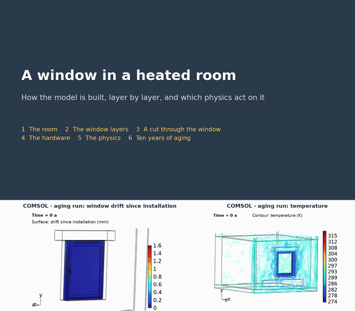

# Digital Twin Window: Ten Years of Aging of a Turn-Tilt Window in a Heated Room (COMSOL Finite Element Model)




A continuum digital twin of a turn-tilt window in a heated room. The window is modelled as it is built and as it is used: closed most of the time, sometimes tilted, sometimes opened wide. Heat transfer, the weights of building and window, and thermal expansion are coupled, and the window is followed through ten years of seasons in one continuous run, so the model shows how the sash slowly drifts out of alignment with its frame.

## Repository contents

| File | Description |
|---|---|
| `Window_DigitalTwin.mph` | COMSOL model file (6.3), saved without solution |
| `Window_DigitalTwin.java` | Model file for Java that builds the complete model from scratch |
| `digital_twin_window_v2.gif` | Animation: how the model is built (top) and COMSOL results of the aging run (bottom) |

## Features

### A realistic window

- Fixed frame with an outer stop lip and an openable sash that closes against it
- Stop gasket that seals between sash and frame, centre gasket in the rebate gap
- Turn-tilt hardware: corner bearing, scissor stay, tilt bearing, locking points and handle
- Double glazing on EPDM bedding with diagonal setting blocks
- PU-foam joint in a masonry wall under a concrete lintel, panel heater below the window
- The storey above standing on the ceiling slab, so the building holds the window as in reality

### It ages like the real one

- **Material memory:** gaskets, bedding, foam, bushings and setting blocks are viscoelastic and carry their history forward in one continuous run
- **Building creep:** masonry and concrete creep under their lasting load, following the Eurocodes
- **Hinge wear:** every opening and every tilt wears the hinges; setting blocks take a permanent set

### It is used like the real one

- Closed, tilted and opened wide, with how often and how long set on the season clock
- Turns and tilts wear different hardware parts
- The time spent open or tilted changes how long each soft part carries its load
- A switch for a window that is never opened, to see the effect of use

### Seasons, heating and sun

Every part expands and shrinks at its own temperature. The outdoor temperature follows the seasons, the heater follows the outdoor temperature, and the sun adds heat on facade, frame and glazing.

### Outputs a fitter would recognise

Gaps between sash and frame, a dropping lock corner, a sash that starts to rub, a gasket that loses contact, hinge forces, and the wear and use since installation.

## Studies

| Study | Question it answers |
|---|---|
| 1 Aging with realistic use | How does the fit between sash and frame drift over years of normal use? |
| 2 Design winter day | Does the sash still fit on the coldest day, right after installation? |
| 3 Sash tilted | How do the hinges share the weight of the tilted sash? |
| 4 Sash turned open | What do the hinges carry when the sash hangs open? |
| 5 Aging, window never opened | How would the same window age without use? Compare with Study 1 |

## How to run

### Option A: open the model file

Open `Window_DigitalTwin.mph` in COMSOL 6.3 or newer and press *Compute* on the studies you need. The file is saved without a solution to keep it small.

### Option B: build from the Java file

The Java file is not tied to the COMSOL version that saved it, unlike the `.mph`. Compile it with the `comsolcompile` of your own installation.

Windows (PowerShell; note the `&`):

```powershell
& "C:\Program Files\COMSOL\COMSOL63\Multiphysics\bin\win64\comsolcompile.exe" .\Window_DigitalTwin.java
& "C:\Program Files\COMSOL\COMSOL63\Multiphysics\bin\win64\comsolbatch.exe" -inputfile "$PWD\Window_DigitalTwin.class" -outputfile "$PWD\Window_DigitalTwin.mph" -batchlog "$PWD\build.log"
```

Linux / macOS:

```bash
comsol compile Window_DigitalTwin.java
comsol batch -inputfile Window_DigitalTwin.class -outputfile Window_DigitalTwin.mph -batchlog build.log
```

Then open `Window_DigitalTwin.mph`. The Java file must keep its exact name. If a setting cannot be made in your COMSOL version, the log contains a line starting with `NOTE` that says what to set by hand.

### Option C: run on a cluster

Each run starts from the output of the previous one, so the final file holds all solutions:

```bash
prev=Window_DigitalTwin.mph
for s in std1 std2 std3 std4 std5; do
  comsol batch -inputfile "$prev" -outputfile "Window_DigitalTwin_$s.mph" -study $s -batchlog $s.log
  prev="Window_DigitalTwin_$s.mph"
done
```

### Adjust the model

All inputs are parameters under *Global Definitions*, for example:

- **Use:** `n_turn`, `t_turn_w`, `t_turn_s` (full openings per day and their duration in winter and summer), `n_tilt_s`, `h_tilt` (tilts per day in summer and their duration), `f_use` (0: never opened)
- **Run:** `dt_out` (output interval), `t_end` (duration)
- **Hardware:** `f_lifter` (sash lifter when closed)

Climate, heating, material relaxation and hinge wear can be replaced by measured data to calibrate the twin to a real window.

### Requirements

- COMSOL Multiphysics 6.3 or newer
- Structural Mechanics Module (viscoelasticity)

## About the animation

The top part illustrates how the model is built and which physics act on it (schematic drawings). The bottom part shows COMSOL results of the aging run: the drift of the window since installation and the temperature, at the same moment.
